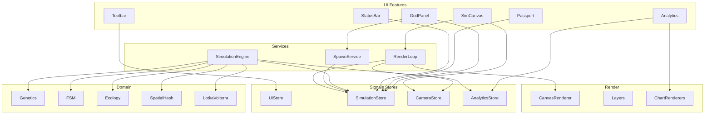

# 02 — Architecture (Angular 22+)

Создай приложение строго по этой архитектуре. Не сваливай симуляцию и генетику в компоненты. Не используй NgRx/Akita — только Signals stores.

---

## 2.1 Стек и bootstrap

1. Создай проект Angular **latest stable ≥ 22**, standalone, SCSS, **без SSR**, без routing (предпочтительно **без** `@angular/router`).
2. Включи **zoneless** (дефолт новых приложений). Не добавляй `zone.js` обратно.
3. Prefix: `bev`.
4. Точка входа: `main.ts` → `bootstrapApplication(AppComponent, appConfig)`.
5. `app.config.ts`: `provideZonelessChangeDetection()` (или эквивалент актуального API), никаких обязательных `provideAnimations` (анимации панелей — CSS).

---

## 2.2 Дерево каталогов (обязательное)

```
src/
  index.html
  main.ts
  styles.scss
  app/
    app.component.ts
    app.component.html
    app.component.scss
    app.config.ts

    core/
      constants/
        world.constants.ts
        genetics.constants.ts
        simulation.constants.ts
        render.constants.ts
        ecology.constants.ts
      models/
        vec2.model.ts
        dna-genes.model.ts
        agent.model.ts
        plant.model.ts
        agent-kind.model.ts
        agent-fsm-state.model.ts
        world-config.model.ts
        simulation-settings.model.ts
        population-sample.model.ts
        gene-stats.model.ts
        lotka-volterra.model.ts
        camera-state.model.ts
        theme.model.ts
        locale.model.ts

    domain/
      genetics/
        gene-ranges.ts
        random-dna.ts
        crossover.ts
        mutate.ts
        gene-stats.ts
      ai/
        prey-fsm.ts
        predator-fsm.ts
        steering.ts
      ecology/
        energy.ts
        feeding.ts
        hunting.ts
        reproduction.ts
        plant-growth.ts
      population/
        spatial-hash.ts
        nearest.ts
      math/
        lotka-volterra.ts
        clamp.ts
        rng.ts

    state/
      simulation.store.ts
      camera.store.ts
      ui.store.ts
      analytics.store.ts

    services/
      simulation-engine.service.ts
      render-loop.service.ts
      spawn.service.ts
      screenshot.service.ts
      hotkeys.service.ts
      i18n.service.ts

    features/
      sim-canvas/
        sim-canvas.component.ts
        sim-canvas.component.html
        sim-canvas.component.scss
        canvas-renderer.ts
        canvas-camera.ts
        canvas-pointer.controller.ts
        layers/
          grid.layer.ts
          plants.layer.ts
          agents.layer.ts
          selection.layer.ts
      god-panel/
        god-panel.component.ts
        god-panel.component.html
        god-panel.component.scss
      passport/
        genetic-passport.component.ts
        genetic-passport.component.html
        genetic-passport.component.scss
      analytics/
        analytics-panel.component.ts
        analytics-panel.component.html
        analytics-panel.component.scss
        population-chart.component.ts
        population-chart.component.html
        population-chart.component.scss
        population-chart.renderer.ts
        gene-stats-view.component.ts
        gene-stats-view.component.html
        gene-stats-view.component.scss
        lv-compare-chart.component.ts
        lv-compare-chart.component.html
        lv-compare-chart.component.scss
        lv-compare-chart.renderer.ts
      toolbar/
        toolbar.component.ts
        toolbar.component.html
        toolbar.component.scss
      status-bar/
        status-bar.component.ts
        status-bar.component.html
        status-bar.component.scss
      hotkeys-help/
        hotkeys-help.component.ts
        hotkeys-help.component.html
        hotkeys-help.component.scss

    i18n/
      locale.type.ts
      i18n.keys.ts
      dictionaries/
        ru.ts
        en.ts

  # tests рядом с domain:
  app/domain/genetics/crossover.spec.ts
  app/domain/genetics/mutate.spec.ts
  app/domain/math/lotka-volterra.spec.ts
  app/domain/ai/prey-fsm.spec.ts
  app/state/simulation.store.spec.ts
```

Имена файлов **фиксированы**. Не переименовывай произвольно.

---

## 2.3 Слои и границы ответственности



### Правила
1. **UI-компоненты** читают stores через `inject(...)`, вызывают методы store/service (`play()`, `spawnPrey(50)`). Не импортируют `crossover.ts` / `lotka-volterra.ts` напрямую (исключение: chart renderers могут читать готовые series из AnalyticsStore).
2. **SimulationEngineService** — единственное место тика мира: движение, FSM, еда, охота, размножение, смерть, LV step, запись истории. Не трогает DOM/Canvas.
3. **CanvasRenderer / layers** — только рисование из snapshot state. Не мутируют агентов.
4. **CameraStore** — pan, zoom, followEnabled, focusAgentId.
5. **UiStore** — theme, locale, hotkeysHelpOpen, sidebar/drawer open на mobile.
6. **AnalyticsStore** — кольцевые буферы population history, LV history, computed gene averages.

---

## 2.4 Signals Store — контракты

### `SimulationStore`
Writable signals:
- `isPlaying: signal(true)`
- `tick: signal(0)`
- `simulationTime: signal(0)` — секунды симуляционного времени
- `settings: signal<SimulationSettings>(DEFAULT_SETTINGS)`
- `world: signal<WorldConfig>(DEFAULT_WORLD)`
- `plants: signal<Plant[]>([])`
- `agents: signal<Agent[]>([])`
- `selectedAgentId: signal<string | null>(null)`
- `lvState: signal<LotkaVolterraState>(...)`

Computed:
- `selectedAgent`
- `counts` → `{ plants, prey, predators }`
- `preyAgents` / `predatorAgents`

Methods:
- `play()`, `pause()`, `togglePlay()`
- `setSettings(partial)`
- `setMutationRate(v)`, `setSelectionPressure(v)`, `setSimSpeed(v)`
- `replaceWorld(plants, agents)`, `resetToDefaults()`
- `selectAgent(id)`, `clearSelection()`
- `applyEngineSnapshot(snapshot)` — вызывается из SimulationEngine после тика

### `CameraStore`
- `offsetX`, `offsetY` (world units → screen; зафиксируй подход в `canvas-camera.ts`)
- `zoom: signal(1)`
- `followEnabled: signal(false)`
- `focusAgentId: signal<string | null>(null)`
- methods: `panBy`, `zoomAt`, `enableFollow(id)`, `disableFollow()`, `fitWorld(world)`

### `UiStore`
- `theme: signal<'dark' | 'light'>('dark')`
- `locale: signal<'ru' | 'en'>('ru')`
- `hotkeysHelpOpen: signal(false)`
- `mobileDrawerOpen: signal(false)`
- methods для toggle/set

### `AnalyticsStore`
- `populationHistory: signal<PopulationSample[]>` (ring buffer, max N)
- `lvHistory: signal<LotkaVolterraSample[]>`
- `geneStats: signal<GeneStatsSnapshot>`
- methods: `pushSample(...)`, `recomputeGeneStats(agents)`, `clear()`

---

## 2.5 Цикл кадра

`RenderLoopService`:
1. Подписка на `requestAnimationFrame`.
2. Считает `dt = (now - last) / 1000`, clamp dt ≤ 0.05.
3. Если `simulationStore.isPlaying()` → `simulationEngine.step(dt * settings.simSpeed)`.
4. Если follow → обновляет camera из позиции focused agent (после step).
5. Вызывает `canvasRenderer.draw(snapshot)`.
6. Старт loop в `SimCanvasComponent` (`afterNextRender` / `ngOnInit`); stop через `DestroyRef`.

**Важно для zoneless:** обновление signal в rAF триггерит CD. Не вызывай `markForCheck`. Не мутируй объекты внутри signal in-place — новый массив/объект через `update` / замена.

**Производительность:** при > 500 агентах не клонируй глубоко каждый кадр без нужды; допустим паттерн: движок мутирует рабочие массивы внутри сервиса и один раз публикует immutable snapshot в store (новый reference массива `agents` / `plants`).

---

## 2.6 AppComponent composition

`app.component.html`:

```html
<bev-toolbar />
<main class="bev-shell">
  <bev-sim-canvas class="bev-shell__canvas" />
  <aside class="bev-shell__side">
    <bev-god-panel />
    <bev-genetic-passport />
    <bev-analytics-panel />
  </aside>
</main>
<bev-status-bar />
@if (ui.hotkeysHelpOpen()) {
  <bev-hotkeys-help />
}
```

`HotkeysService` инициализируется в `AppComponent` через `inject` + `DestroyRef`.

---

## 2.7 Зависимости npm

Разрешены только:
- Angular framework packages из CLI
- RxJS (peer Angular; **не** использовать для state)
- testing libs CLI

**Запрещены:** three, pixi.js, p5, matter.js, ngrx, chart.js, d3, plotly, tailwindcss, immer (не нужен).

---

## 2.8 Именование

- `AgentId` = `string` (uuid-like / monotonic `hare-1`, `wolf-42` — выбери один стиль и используй везде).
- `AgentKind` = `'prey' | 'predator'`.
- Файлы kebab-case, классы PascalCase (`SimCanvasComponent`, `SimulationEngineService`).
- Selectors: `bev-sim-canvas`, `bev-god-panel`, `bev-genetic-passport`, …

---

## 2.9 Критерий готовности документа 02

Дерево папок создано, stores на signals, SimulationEngine отделён от Canvas, UI не импортирует genetics/LV напрямую.
